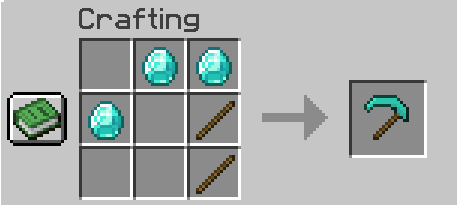

> [!IMPORTANT]
> Maulve's Scythes: Recut is a revival of the mod. It will be released for 1.20.4, 1.21.1, 1.21.4 and 1.21.11 (maybe on 26.x too), on Fabric and NeoForge. There is no ETA.

> [!CAUTION]
> **Recut is early in development, and not ready for players.**

Below is the old README (to be updated).

Maulve's Scythes is a Vanilla+ mod that adds scythes as new weapons. These slightly differ from swords, because they always sweep attack.
You can also mine crops and other plant blocks in a 3x2 area!

---
## ✨ Content

This mod adds various items, including - of course - scythes.

- Iron Scythe
- Diamond Scythe
- Netherite Scythe
- Amethyst Scythe

These are required to craft the Amethyst Scythe:
- Reinforced Stick
- Scythed Amethyst

Also: Enchantments!
- Life Drain (heals player when killing a mob)
- Sweeping Arc (increases sweeping range)

--- 
## ⛏️ Crafting

---
## 🗺️ Roadmap

Currently, planned support is until 1.22 comes out.
Until then I want to release one more major content update:

### 1.4 (March 2025)
- full configuration
- scythes in loot tables (likely end cities and ancient cities)
- further balancing

---
## 📜 License

This project is licensed under the [MIT License](https://mit-license.org/).
You may add this mod to your modpack, as long as you give credit.
